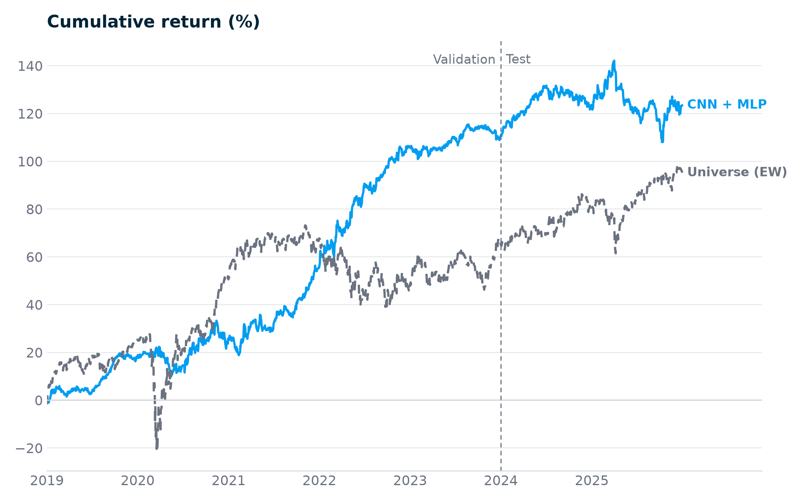
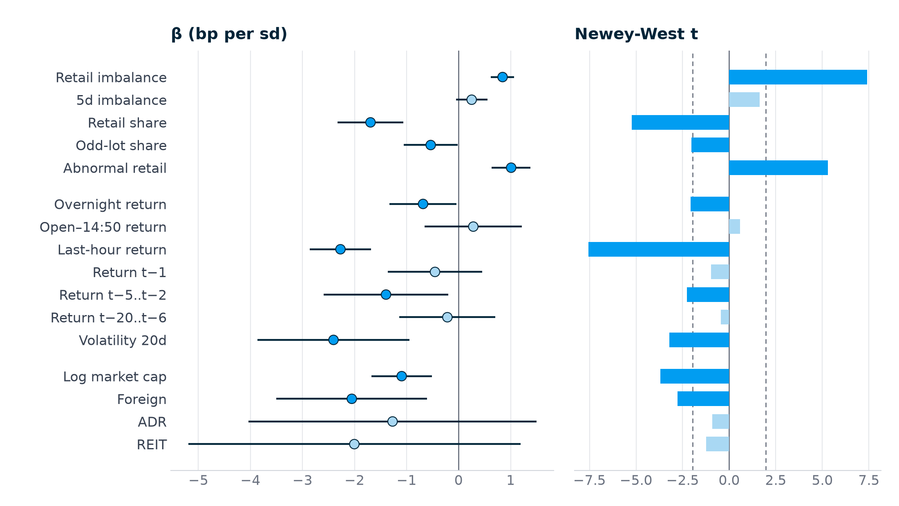
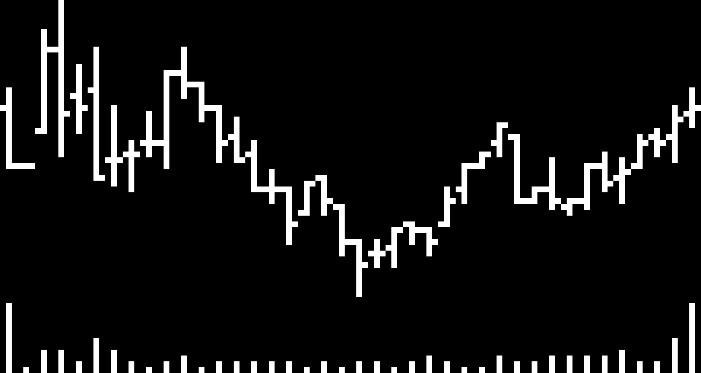

# retail_flow_strategy

**Predicting next-day cross-sectional US stock returns from retail order flow in TAQ:** which liquid stocks will do better than the others tomorrow, not where the market goes.

Positions are set with market-on-close orders sent before 15:50 ET, so every input is known by then. Research only; nothing trades live.



*The final model's top-minus-bottom decile portfolio on stocks of $1B or more, before costs, against the equal-weighted universe. Settings were chosen on 2019-2023; 2024-2025 was run once at the end.*

## In short

- **Signal:** retail trades can be picked out of TAQ, because wholesalers fill them off-exchange at sub-penny prices. Net retail buying predicts higher returns the next day; a high retail share of trading predicts lower ones.
- **Final model:** a two-branch network. A CNN reads the day's price chart, an MLP reads 17 daily features (5 retail, 12 controls), and the two are trained together and refit every year.
- **Validation, 2019-2023:** rank IC 0.0124 (t 5.3) and a Sharpe ratio of 1.60, before costs. LightGBM, the benchmark, got 0.0128 and 1.41.
- **Test, 2024-2025, run once:** the ranking held (IC 0.0137, t 2.9) but the P&L did not (Sharpe 0.41, t 0.5). LightGBM did the same (0.37), and the two can't be told apart.

| | Rank IC (t) | Decile long-short, bp a day (t) | Sharpe (t) |
|---|---|---|---|
| Validation, 2019-2023: two-branch | 0.0124 (5.34) | 8.7 (3.67) | 1.60 (3.72) |
| Validation: LightGBM | 0.0128 (4.60) | 9.2 (3.22) | 1.41 (3.28) |
| **Test, 2024-2025: two-branch** | 0.0137 (2.94) | 2.7 (0.54) | 0.41 (0.54) |
| Test: LightGBM | 0.0135 (2.95) | 2.5 (0.53) | 0.37 (0.54) |

## Why retail flow

Most US retail market orders go to wholesalers, which fill them away from the exchanges and give a small price improvement, often a fraction of a cent. That sub-penny price marks the trade as retail in the public tape (Boehmer, Jones, Zhang & Zhang 2021). Retail investors are many, trade on attention and on what they see in a chart, and their flow persists from day to day, so the direction and the intensity of their trading are candidates for the next day's relative return.

Both show up in the data:
- **Direction:** retail imbalance, net retail buying over all signed retail trades, has the strongest positive slope of the 17 features (t 7.4, see [Features](#features)).
- **Intensity:** the retail share of the dollars traded, the odd-lot share and, in the Robinhood side study, growth in holders all predict lower returns. Retail attention today is followed by underperformance tomorrow.

## Data

| Source | What it gives | Period |
|---|---|---|
| TAQ (WRDS) | Every consolidated US trade, with the NBBO in force when it printed: retail flow, intraday prices and volume | 2014-2025: about 3,000 trading days and 170 billion trades |
| CRSP (WRDS) | Returns with delisting returns, prices, market caps, security types and PERMNOs | 2014-2025 |
| Robintrack | Hourly Robinhood holder counts per stock: a side study and a check on the retail signing | May 2018 - Aug 2020 |

The sample starts on 2014-01-02, after odd lots joined the consolidated tape (2013-12-09).

### From 170 billion trades to one row per stock-day

Each problem with the raw tape, and what was done about it:

| Problem | Fix |
|---|---|
| Too large to store | Each day is cut into 10-minute bars per stock on WRDS Cloud, in parallel jobs, and only the bars are downloaded |
| Special prints (average-price trades and the like) | Dropped by sale condition |
| Late corrections | Only cancels and corrections published before 15:50 are applied; a trade fixed later stays as it printed |
| Tickers change and get reused | TAQ symbol to CUSIP through the TAQ master file of that day, then to CRSP's PERMNO by date: about 99% of trades get one |
| Bad prints in the bars | Bar prices come from round lots (100 shares or more) only. Bad prints hit 1.3% of large-cap stock-days, and most are odd lots outside the official high and low, which odd lots can't set ([reports/bad_prints.md](reports/bad_prints.md)) |

### Finding retail trades

A trade is retail when it printed off-exchange (FINRA TRF) at a sub-penny price. It is signed by the **midpoint rule** of Barber et al. (2024): a buy when it printed above 60% of the way from the bid to the ask, a sell below 40%, and dropped in between. The older BJZZ rule, which signs by the sub-penny fraction alone, is kept as a benchmark. Against Robinhood holder changes, the midpoint rule tracks retail activity more closely than BJZZ on every measure tried (`scripts/robintrack/03_*`).

### Universe

Decided every day with what was known the day before:
- common stock, foreign common stock, ADRs and REITs. ETFs are out: they were 22% of stock-days and mostly copies of a few indices;
- previous close of $1 or more and previous market cap of $100M or more;
- previous day's dollar volume of $100k or more, and $50k or more traded before 15:50 on the decision day and on the day before.

That leaves about 3,700 stocks a day to train on. The models are scored and traded on the roughly 2,100 with a market cap of $1B or more.

## Features

17 numbers per stock-day, all measured before 15:50. Each is winsorized and standardized across stocks every day. Missing retail values are set to 0, which is 2-5% of rows. The largest variance inflation factor is 1.44.

| | Feature | Definition |
|---|---|---|
| Retail (5) | Retail imbalance | (B − S) / (B + S): retail buys and sells, midpoint-signed |
| | 5-day imbalance | Its mean over the last 5 days |
| | Retail share | Retail dollars over all dollars traded |
| | Odd-lot share | Off-exchange trades of 1-99 shares over all off-exchange trades |
| | Abnormal retail activity | log[(1 + N) / (1 + N̄₂₀)]: N retail trades today, N̄₂₀ their mean over the 20 days before |
| Controls (12) | Returns | Overnight, open to 14:50, the last hour to 15:50, day t−1, t−5 to t−2, t−20 to t−6 |
| | Risk and size | 20-day volatility, log market cap |
| | Flags | Foreign, ADR, REIT, early close |



*Slope of the next day's return on each feature (bp per standard deviation) and its Newey-West t. Light markers are not significant at 5%.*

## Target, validation and backtest

- **Target:** the next day's close-to-close return, with delisting returns, winsorized at the 1st and 99th percentiles and minus that day's average. Stocks above and below $1B are handled separately. Every model minimizes squared error on it.
- **Split:**
  - train 2014-2023, test 2024-2025;
  - validation is an expanding-window walk-forward over 2019-2023, with at least five years of training data behind each refit;
  - hyperparameters were tuned there with W&B sweeps, then frozen. The test was run once.
- **Refits:** the baselines every month; the CNNs, the two-branch model and LightGBM as their benchmark every year.
- **Portfolio:** every day, rank the stocks of $1B or more by prediction, buy the top tenth and short the bottom tenth, equal-weighted, $1 a side, at the close; hold one day. All before costs.
- **Statistics:** the t of every mean is Newey-West with 5 lags; the Sharpe ratio's comes from the delta method (`dsr.backtest.sharpe_t`).

## Models

1. **Three baselines on the 17 features:**
   - **Ridge:** an elastic net whose tuning settled on pure ridge.
   - **LightGBM.**
   - **MLP:** 17 → 16 → 8 → 1.
2. **A CNN on price images,** after Jiang, Kelly & Xiu (2023).
   - **The image:** each stock-day is a 64 × 120 pixel chart of 40 ten-minute bars: the previous day's last bar (15:50-16:00), the overnight move, and today from 09:30 to 15:50. Price bars are on top and volume below.
   - **The network:** three blocks of 5×3 convolution, batch norm, LeakyReLU and 2×1 max-pooling, with 32, 64 and 128 filters, then a linear readout. About 200k weights.
   - **A retail variant** added three colour channels to the bars: imbalance with retail share, abnormal activity, and average imbalance with odd-lot share.
3. **The two-branch model,** the final one, built in three steps:
   - **Step 1:** the grey CNN and the MLP are each trained alone.
   - **Step 2:** a small combined head is trained on top of the frozen branches, reading the CNN's prediction and the MLP's last hidden layer.
   - **Step 3:** the head, the MLP's last layer and the CNN's last block and readout are fine-tuned together on λ·L_price + (1 − λ)·L_combined, with λ = 0.1. Across λ from 0 to 0.9, the validation Sharpe stays between 1.52 and 1.62.



*One input image, as the network sees it: SCCO on 2016-10-03.*

## Results

### Validation, 2019-2023

| Model | R² | Rank IC (t) | Sharpe | Daily turnover |
|---|---|---|---|---|
| Ridge | 0.019% | 0.0131 (4.0) | 1.10 | 61% |
| LightGBM | 0.023% | 0.0123 (4.1) | 1.18 | 61% |
| MLP | 0.017% | 0.0123 (4.2) | 1.14 | 60% |
| CNN, grey chart | −0.065% | 0.0046 (2.5) | 0.86 | 89% |
| CNN, grey + 3 retail channels | −0.046% | 0.0047 (2.5) | 0.65 | 88% |
| LightGBM, refit yearly (benchmark) | 0.026% | 0.0128 (4.6) | 1.41 | |
| **Two-branch (CNN + MLP)** | 0.013% | 0.0124 (5.3) | **1.60** | 78% |

- **The signal, not the model, sets the level.** The three baselines reach the same IC of about 0.012-0.013, and their daily long-short returns are 51-81% correlated.
- **The CNN alone is weak, and colouring the bars by retail flow adds nothing.** But its long-short is only 10-15% correlated with the baselines', and adding it to the MLP lifts the Sharpe ratio from 1.14 to 1.60 at the same IC.
- **The CNN learned an intraday reversal.** It ranks highest the stocks that sold off after the open and closed on heavy volume ([average chart of its top and bottom picks](output/saliency/inside_cnn_mean_charts_top_bottom.png)).
- **The baselines' returns are not the usual factors.** Against the Fama-French five factors and momentum, their alpha is 17-19% a year (t 2.5-3.1). The largest loading is on profitability (RMW).

| Risk, validation | Ridge | MLP | LightGBM (yearly) | Two-branch |
|---|---|---|---|---|
| Sharpe | 1.10 | 1.14 | 1.41 | 1.60 |
| Sortino | 1.70 | 1.72 | 2.20 | 2.49 |
| Maximum drawdown | −23.5% | −20.2% | −25.3% | −14.4% |
| Longest drawdown | 183 days | 185 days | 104 days | 101 days |
| Winning days | 51.7% | 53.1% | 52.2% | 54.6% |
| Breakeven one-way cost | 3.3 bp | 3.2 bp | 3.8 bp | 2.8 bp |

### Test, 2024-2025

Run once, with every setting frozen. An earlier LightGBM run on the test years (2026-10-24) stays sealed and unread.

| | Two-branch | LightGBM |
|---|---|---|
| Rank IC (t) | 0.0137 (2.94) | 0.0135 (2.95) |
| Long-short, bp a day (t) | 2.7 (0.54) | 2.5 (0.53) |
| Annual return / volatility | 6.9% / 16.9% | 6.3% / 17.0% |
| Sharpe: 2024, 2025, both years | 1.06, 0.00, 0.41 | 0.44, 0.33, 0.37 |
| Maximum drawdown | −34.1% | −24.2% |
| Daily turnover | 65% | 60% |

- **The ranking held up; the returns did not.** The IC is as large as in validation and still significant. The long-short earned about a third of what it did in validation, and neither model's Sharpe ratio can be told from zero.
- **The two models can't be told apart.** Their daily long-short returns are 88% correlated, and the difference in Sharpe ratio is +0.04 (95% interval −0.65 to +0.71).

## Robinhood side study

Robintrack recorded how many Robinhood accounts held each stock, every hour, from May 2018 to August 2020. Each day's count is the last reading before 15:50, and stocks are matched to CRSP PERMNOs by date, never by ticker.

On the training days, holder growth, the volatility of that growth, and holders above their recent average all predict lower next-day returns (joint F-test p = 0.0001). Robintrack stopped in 2020, so the main study uses the retail flow in TAQ, which runs to today.

## Caveats

- **Costs:** every number above is before costs. At 60-80% daily turnover, the long-shorts break even at 2.8-3.8 bp of one-way cost.
- **Noisy retail signing:** Barber et al. (2024) find that sub-penny prices catch only about a third of retail trades, and that the midpoint rule signs about 95% of them correctly, against 72% for BJZZ.
- **Regulation:** the half-penny tick sizes the SEC adopted in 2024 may blur the sub-penny marker that identifies retail trades.
- **The test:** two years of out-of-sample returns indistinguishable from zero, with a flat 2025, are not evidence that the strategy works after costs.

## Next steps

- Run the final model, with its settings unchanged, on January-June 2026 (in progress).
- Identify retail trades better, or build a retail dataset directly.
- Combine the models (a mixture of experts) instead of choosing one.
- Try other image designs beyond Jiang, Kelly & Xiu.
- Factor-adjust the final model's returns, as done for the baselines.

## Rules every input follows

- **No lookahead past the 15:50 cutoff.** Data are dated by when they became public, not by the event they describe.
- **No survivorship bias.** Universe membership is decided each day with what was known that day. Delisted stocks and their delisting returns stay in, and securities are identified by PERMNO matched by date.
- **Settings chosen on the training years only.** That covers floors, cutoffs, winsorizing, model choices and hyperparameters; the test years were used once.

## Layout

```
scripts/
  data_acquisition/  # raw data, downloaded unchanged: TAQ (the pull runs on WRDS Cloud, wrds_cloud/), CRSP, Robintrack
  taq/               # clean and explore (01), the model panel and the CNNs' image data (02), checks/
  robintrack/        # clean and explore (01), holder changes and returns (02), the retail-signing rules against it (03)
  models/            # sweeps (03), walk-forward (04), backtest (05), CNNs (06-08), two-branch model (10),
                     # stress test (11), the test (12)
src/dsr/             # reusable code
tests/               # its tests
notebooks/CNN/       # inside the CNNs: the images, kernels and saliency
reports/             # the odd-lot bad prints, and figures
output/              # figures and the tables behind them
data/                # local only (gitignored)
```

## Setup

```bash
uv sync
uv run pytest
```

**Data access:** none of the data is in the repo; `data/` stays local.
- TAQ and CRSP come from WRDS and need a subscription. The full TAQ pull runs on WRDS Cloud (`scripts/data_acquisition/wrds_cloud/`).
- Robintrack's holder counts are public.
- The tests need no data.

The scripts are marimo notebooks.
- **To open one:** `uv run marimo edit scripts/models/05_backtest.py`.
- **To run a long job from the terminal:** each script's "Running it" cell lists its commands. For example, LightGBM's yearly walk-forward is `uv run python scripts/models/04_walkforward.py run --models lgbm --every year`.

## References

- Barber, B. M., Huang, X., Jorion, P., Odean, T., & Schwarz, C. (2024). A (sub)penny for your thoughts: Tracking retail investor activity in TAQ. *Journal of Finance*.
- Boehmer, E., Jones, C. M., Zhang, X., & Zhang, X. (2021). Tracking retail investor activity. *Journal of Finance*.
- Jiang, J., Kelly, B., & Xiu, D. (2023). (Re-)Imag(in)ing price trends. *Journal of Finance*.
