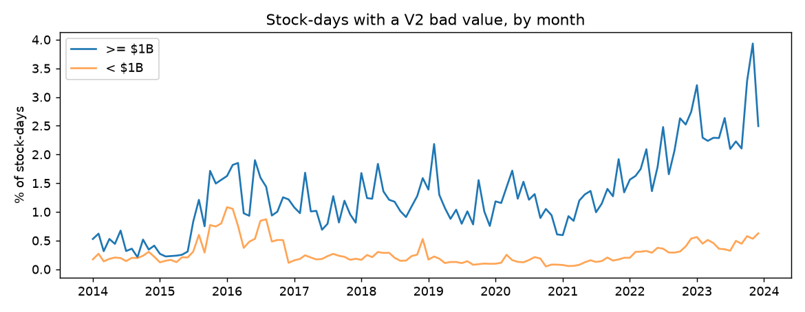
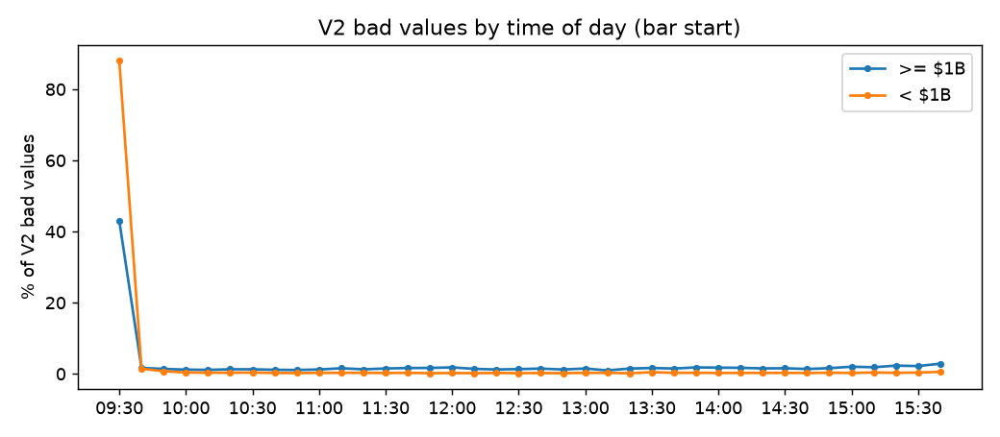
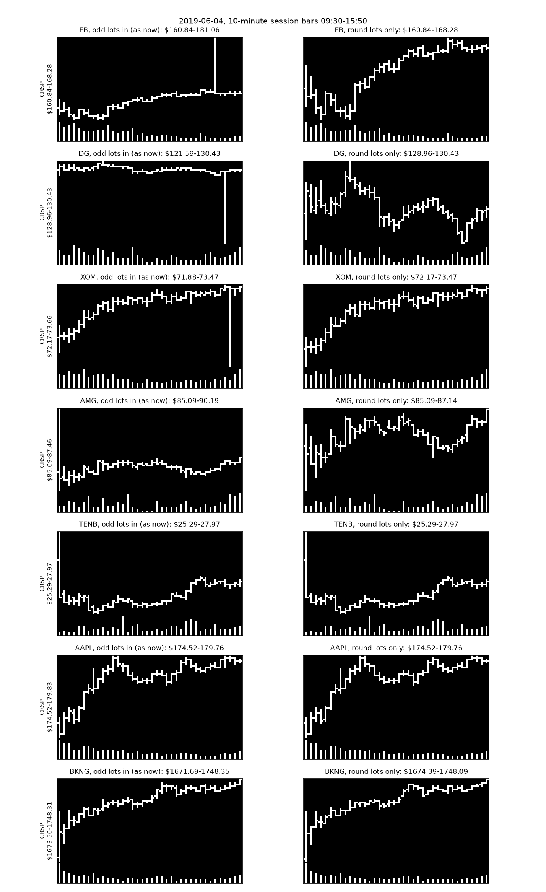
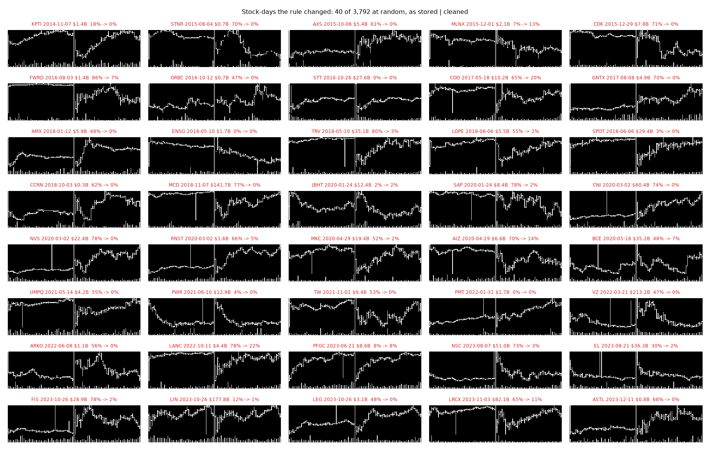
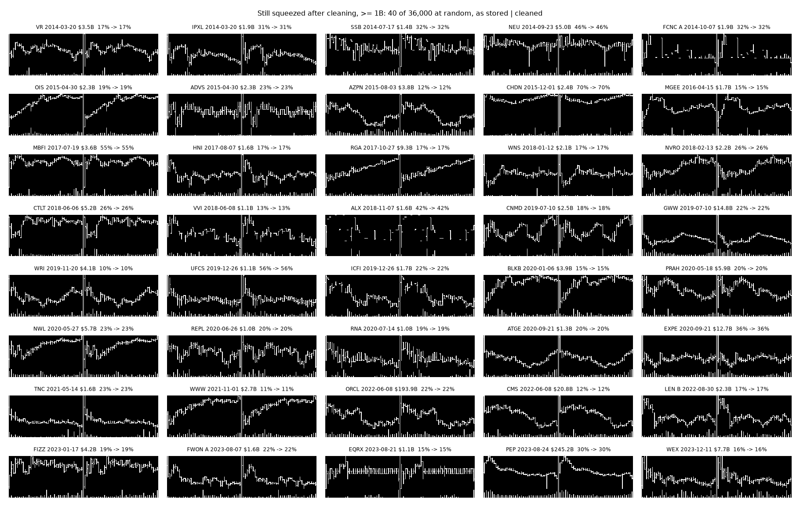
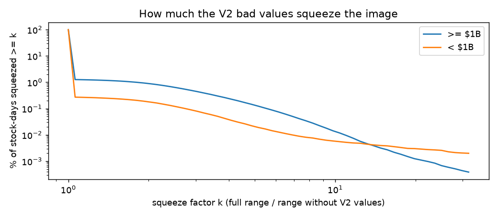
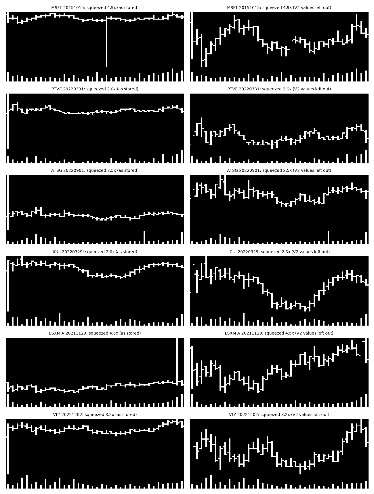

# Bad prints in the ten-minute bars

A scan of every session bar on the 2,516 training days (2014-01-02 to 2023-12-29) for prices that cannot be where the stock traded: 346 million bars, 9.4 million stock-days. A second round compared the bars with CRSP's official daily high and low, went through the raw trades of 2019-06-04 (the one day whose trades are on disk), and tested a cleaning rule on 100 random training days in the image notebook. Test days were not read. Run on 2026-10-16; the scans only read `data/`, and besides this report the only change in the repo is the cleaning and its check in `notebooks/CNN/test_image.py`.

The question came from the first chart image (`notebooks/CNN/test_image.py`): on 2019-06-12 one AAPL bar had a low of $178.80, 8% below every other price that day. The image is scaled to the day's highest high and lowest low, so that one print squeezed the rest of the day into a sixth of the image.

## The answer

1. **Bad prints are real, they hit about 1 in 75 large-cap stock-days, and the rate is rising.**
   - 1.32% of stock-days at or above $1B have at least one (rule V2, below), about 72,000 stock-days over the ten years. Below $1B it is 0.28%.
   - Large caps went from 0.44% of stock-days in 2014 to 2.59% in 2023, near 4% in November 2023. The test years follow.
2. **They are mostly odd lots.** The official daily high and low leave out odd lots (trades under 100 shares, sale condition `I`); the bars keep them.
   - 84% of the large-cap bad values lie outside CRSP's official range for the day, rising from 64% in 2014 to 95% in 2023.
   - On 2019-06-04 the day's trades without odd lots reproduce the official high and low of 99% of large caps (41-71% with odd lots in), and 16 of the 19 trades behind that day's bad values are odd lots.
3. **There are two kinds.**
   - **In the 09:30 bar** (half of the large-cap bad values): small fills in an opening market that has not formed yet, inside quotes several percent wide or before the stock has a quote at all. Real trades, but not what a chart shows.
   - **After the open:** prices several percent outside a quote a cent wide, which nobody could have traded at that moment. Stale or misreported prices; a small part are exactly an earlier official close.
4. **They matter for the images, not for the current features.**
   - In 100 random training days, 1.9% of large-cap images have half or more of their price height outside the official range, and 17.9% at least a tenth of it.
   - The prices the tabular features use (the last trade before 15:50 and before 14:50) are almost never hit: 6 large-cap stock-days in ten years under rule V2.
5. **The fix is to build each bar's prices from round lots only.** On 2019-06-04 that removes 16 of the 19 bad trades and brings the large caps whose range goes past the official one from 39% to 0.1%. It needs the bars rebuilt on WRDS.
6. **Rule V2 alone is not enough.** In the notebook it is precise (85% of what it removes lies outside the official range) and takes out the big spikes, but it fixes only 6% of the squeezed large-cap images: most of the squeeze comes from odd-lot wicks below its thresholds. It stays as a backstop for round-lot strays.
7. **The notebook's provisional rule was far too aggressive and is replaced by V2.** "A wick beyond the open-close body longer than 5 median bar ranges" flagged 5.3% of large-cap and 13.2% of small-cap stock-days, mostly ordinary opening bars.

## How a bad print is defined

A bad print is a price far from both the price before it and the price after it. A real move, even a fast one, stays close to one of them: a stock that falls 3% inside a bar has its high near the price before and its low near the price after. For each session bar (a stock's bars with trades, in time order):

- **Before:** the previous bar's close; for the stock's first bar, CRSP's official open.
- **After:** the median of the bar's close, its last NBBO midpoint and the next bar's open; for the last bar, the last midpoint.
- **Low and high:** how far they lie beyond both before and after (0 if not beyond both).
- **Open:** its distance from the nearer of before and after.
- **Close:** its distance from the nearer of the quote midpoint standing at that trade and the next bar's open.
- **Typical move:** the stock's median bar-to-bar move that day (the change in "after" from one bar to the next), at least one quoted spread. A crash day has large typical moves, so it needs a larger deviation to count.

| Rule | A value is bad if it is beyond both neighbors by |
|---|---|
| R2 | at least 2% and at least 20 quoted spreads |
| R5 | at least 5% and at least 20 quoted spreads |
| V1 | at least 1% and at least 20 typical moves |
| **V2 (main)** | **at least 2% and at least 20 typical moves** |
| V5 | at least 5% and at least 20 typical moves |
| V2x | at least 2% and at least 50 typical moves |
| W | the notebook's provisional rule: a wick beyond the open-close body longer than 5 median bar ranges |

Every input is known by the 15:50 cutoff (the bars up to it, the official open, the session's quoted spread), so the rule can be applied when an image is drawn. The thresholds were chosen here, on training days only.

Two simpler versions were tried first and dropped:
- **A median of the bar's prices as the reference** flagged real moves: when a price moves 2% inside a bar, most of the prices in the median sit at the new level and the old level looks "bad". Half of its flags were ordinary opening moves.
- **A fixed 2% threshold** (with 20 spreads) flagged 29% of large-cap stock-days on 2020-03-16 (the COVID circuit breaker) and 37% on 2015-08-24. With the typical-move scaling it is 0.75% and 9%. On calm days the two agree (1.3% and 0.9% on 2019-06-12).

**The limit of bar data:** a bar keeps only its open, high, low, close and last midpoint. A real plunge-and-recover inside ten minutes and a stray trade look the same. Only the trades, each with the quote standing at it, can separate them; one day of them is in [The cause: odd lots](#the-cause-odd-lots).

## How often

### By rule

Stock-days with at least one bad value, %:

| Rule | >= $1B | < $1B | all |
|---|---:|---:|---:|
| R2 | 2.521 | 0.603 | 1.715 |
| R5 | 0.644 | 0.304 | 0.501 |
| V1 | 1.526 | 0.290 | 1.006 |
| **V2** | **1.317** | **0.284** | **0.883** |
| V5 | 0.532 | 0.184 | 0.386 |
| V2x | 0.315 | 0.011 | 0.187 |
| W | 5.301 | 13.178 | 8.612 |

An affected stock-day has 1.25 bad values on average (large caps, V2). Small caps are hit less under V2 because their spreads and typical moves are wider (median 38.5 bp and 41.7 bp, against 9.0 bp and 15.1 bp for large caps), so the same stray trade is fewer typical moves away.

### Over time

| Year | V2, >= $1B | V2, < $1B | V5, >= $1B | V2 stock-days, >= $1B |
|---|---:|---:|---:|---:|
| 2014 | 0.437 | 0.203 | 0.101 | 2,248 |
| 2015 | 0.754 | 0.378 | 0.252 | 3,936 |
| 2016 | 1.373 | 0.634 | 0.406 | 6,836 |
| 2017 | 1.033 | 0.203 | 0.292 | 5,422 |
| 2018 | 1.294 | 0.249 | 0.536 | 7,075 |
| 2019 | 1.140 | 0.128 | 0.406 | 6,042 |
| 2020 | 1.173 | 0.137 | 0.636 | 6,107 |
| 2021 | 1.204 | 0.129 | 0.482 | 7,741 |
| 2022 | 2.007 | 0.329 | 0.973 | 11,920 |
| 2023 | 2.586 | 0.473 | 1.137 | 14,466 |

Two steps in the large caps: one in mid-2015 (from about 0.4% to 1.5%) and a steady climb from 2021. The share of V2 values that lie outside the official range climbs with them, from 64% in 2014 to 95% in 2023: more and more of them are odd lots. The mid-2015 step is not explained.

### By price

Stock-days with a V2 bad value by previous close, %:

| Previous close | >= $1B | < $1B |
|---|---:|---:|
| $1-5 | 0.131 | 0.107 |
| $5-20 | 0.747 | 0.337 |
| $20-100 | 1.203 | 0.305 |
| >= $100 | 2.406 | 0.118 |

### By day

Most days have a few: on the median day 0.96% of large-cap stock-days have a V2 bad value; on the worst 1% of days, more than 6.3%. The days with the most:

| Day | Stock-days | V2 | R2 | % in the 09:30 bar | % at a price traded earlier |
|---|---:|---:|---:|---:|---:|
| 2023-10-23 | 3,603 | 367 | 458 | 5 | 5 |
| 2023-01-24 | 3,924 | 326 | 354 | 86 | 7 |
| 2019-02-05 | 3,526 | 317 | 343 | 6 | 4 |
| 2022-07-19 | 4,021 | 284 | 344 | 10 | 14 |
| 2016-06-23 | 3,533 | 229 | 244 | 10 | 5 |
| 2015-08-24 | 3,657 | 223 | 825 | 69 | 26 |
| 2019-02-22 | 3,524 | 214 | 251 | 2 | 42 |
| 2020-01-24 | 3,578 | 200 | 226 | 2 | 2 |
| 2020-08-11 | 3,686 | 189 | 274 | 7 | 8 |
| 2023-08-09 | 3,765 | 186 | 248 | 10 | 22 |

- **2023-01-24:** the day of NYSE's opening malfunction, when many NYSE-listed stocks opened at wrong prices; 86% of that day's bad values are in the 09:30 bar. Whatever was not cancelled afterwards is still on the tape.
- **2015-08-24:** the flash-crash Monday. Many of its flags are real plunges that recovered within minutes, which the bars cannot tell from stray prints.
- **2023-10-23, 2019-02-05, 2020-01-24 and the others:** hundreds of stock-days spread over the day with no market event I know of. They look like days when some venue or feed printed bad trades, and are the first ones to check on WRDS.

## What kind of bars

| | >= $1B | < $1B |
|---|---:|---:|
| Low | 55.7% | 44.6% |
| High | 44.0% | 53.7% |
| Close | 0.3% | 1.6% |
| Open | 0.0% | 0.1% |
| In the 09:30 bar | 43.0% | 87.9% |
| 09:40-10:20 | 5.4% | 2.9% |
| 10:30-15:20 | 45.4% | 8.0% |
| 15:30-15:50 | 5.0% | 0.9% |
| Bars with more than 100 trades | 77.7% | 29.1% |
| Bars with 20 trades or fewer | 3.9% | 25.1% |
| At a price traded earlier in the window | 13.0% | 6.7% |

- **Almost all are highs and lows**, not opens and closes: one trade inside a bar, not the first or the last.
- **The 09:30 bar holds a large share.** It is the bar with the most real volatility, so part of its flags may be genuine opening spikes; the rest of the day is flat, which is what stray prints look like.
- **Large-cap ones are in busy bars**, where a real 2% round trip inside ten minutes would be rare.
- **Few are at an old price.** A trade reported late carries the price it was made at, which the stock traded at earlier; only 13% of the large-cap ones are like that. "Earlier" covers the previous day's last ten minutes and evening, the pre-open and the earlier session bars. The cleaning already drops trades flagged late or out of sequence (`L`, `Z`) and prior-reference-price trades (`P`), so whatever is left carries normal codes. Exact matches with an earlier official close are rarer still ([below](#two-kinds)).

## The cause: odd lots

### Against the official range, all training days

CRSP's official daily high and low (`dlyhigh`, `dlylow`, on days with a trade price) are built from trades eligible to set the price. Odd lots are not: since December 2013 they reach the consolidated tape with sale condition `I`, count toward volume, and cannot set the last price, the high or the low. The bars keep odd lots, and run to 15:50 without the auctions. So a CRSP range wider than the bars' is normal (it covers 15:50-16:00 and the auctions), and a bar price above the official high or below the official low is a trade the official tape does not count.

Where the V2 bad values sit against the day's official range:

| | >= $1B | < $1B |
|---|---:|---:|
| V2 bad values | 90,116 | 16,160 |
| Outside the official range (by more than a cent) | 84.4% | 68.2% |
| At the official high or low | 12.4% | 28.3% |
| Inside it | 3.1% | 3.5% |
| Outside, in the 09:30 bar | 76.7% | 70.3% |
| Outside, in later bars | 92.5% | 47.8% |

Outside the official range, >= $1B, by year:

| 2014 | 2015 | 2016 | 2017 | 2018 | 2019 | 2020 | 2021 | 2022 | 2023 |
|---:|---:|---:|---:|---:|---:|---:|---:|---:|---:|
| 63.8% | 65.3% | 73.0% | 79.5% | 80.1% | 82.1% | 85.9% | 89.5% | 93.3% | 94.8% |

The values at the official high or low are trades the official record has too: real moves, or round-lot strays. They are most common in the 09:30 bar (20.7% of its large-cap values, against 3.8% later).

Stock-days by how far the bars' range goes past the official one, %:

| Beyond the official range by | >= $1B, V2 flags it | >= $1B, V2 does not | < $1B, V2 flags it | < $1B, V2 does not |
|---|---:|---:|---:|---:|
| more than a cent | 88.5 | 45.0 | 71.5 | 42.5 |
| more than 0.5% | 83.5 | 8.9 | 66.2 | 21.7 |
| more than 2% | 65.6 | 0.94 | 56.8 | 4.7 |

Small odd-lot excursions past the official range are everywhere. Even past 2%, the stock-days V2 does not flag (about 50,000 large-cap ones) are two thirds as many as those it does.

### Trade by trade, 2019-06-04

The raw trades of 2019-06-04 are on disk (`data/raw/taq/2019-06-04/wct.parquet`, with the national best bid and offer at each trade). Each stock's daily high and low rebuilt from different sets of trades, against CRSP's (2,068 stocks of $1B or more, equal within half a cent):

| Trades | High = CRSP | Low = CRSP |
|---|---:|---:|
| The bars' trades: normal codes, odd lots in, 09:30-15:50 | 40.5% | 59.1% |
| Same, to 16:00 with the auctions | 71.0% | 63.1% |
| **Codes that can set the price, odd lots out, to 16:00 with the auctions** | **99.0%** | **99.9%** |
| Same, primary exchange only | 50.1% | 41.3% |

Keeping the 493 trades cancelled later changes nothing. So the official range is built from all venues, without odd lots; the bars' range is built with them.

The day's 23 V2 bad values come from 19 trades:
- **16 odd lots,** 6 of them a single share: 9 reported off-exchange (FINRA, `D`), 4 on Cboe BZX, one each on Cboe BYX, NYSE and NYSE Arca. 15 lie outside the official range.
- **3 round lots,** each setting CRSP's own high or low: HTBK, 700 shares in an intermarket sweep at 10:25; TENB and SFNC, 100 shares off-exchange at 09:30.

### Two kinds

The 16 odd lots against the quote standing at each:

| When | Odd lots | Against the quote |
|---|---|---|
| 09:30:00-09:31:46 | NMRK, ETR, HOLX, PPBI, REZI, IPG, ZION, AMG | six inside the quote, which was 3-10% wide in the first seconds; two (ETR, AMG) before the stock had a quote |
| 11:33-15:21 | ELAN, RAD, FB, DD, DG, WAB, XOM, HD | all 2-11% outside a quote 0-0.24% wide; FB: 26 shares at $181.06 against $167.98 / $168.00 |

- **At the open:** small orders filled at the edge of a wide quote, or before there was one. Real trades, in a market that has not formed yet; the official range leaves them out only because they are odd lots.
- **After the open:** prices nobody could trade at that moment. Some carry an earlier price. Over all training days, 0.8% of large-cap V2 values are exactly the previous day's official close, against 0.03-0.04% at that close shifted by 1 to 5 cents (about 25 times chance); another 3.6% equal one of the four closes before it (no chance comparison). Exact matches are 0.1% in the 09:30 bar and 2.5% after 14:30. On 2019-06-04 four 1-share prints between 15:14 and 15:21 (XOM, HD, WAB, DD) were each exactly the previous close. Where the other prices come from is not known.

### Why odd lots

Not tested:
- A stray odd lot costs little, so nobody is likely to have it cancelled as clearly erroneous; a stray round lot is more likely to be, and cancellations published before 15:50 are already dropped.
- An odd lot cannot set the official last price, high or low, so a wrong one reaches no chart, no CRSP price and no trading-halt band. Only bars built from raw trades show it, and nobody downstream has a reason to correct it.
- Odd lots grew as a share of trades over 2014-2023, and the share of V2 values outside the official range grew with them.

One test points the other way: on 2019-06-04, 25 of the 27.7 million trades of large caps printed more than 2% outside the quote, 14 odd lots and 11 round lots, about as often per trade. The round lots there were not looked at; some may be fast moves where the matched quote lags.

## Rebuilding the bars from round lots (2019-06-04)

The session bars of 2019-06-04 rebuilt from the raw trades without odd lots, with the volume still counting every trade, for the 2,068 stocks of $1B or more:

| | Odd lots in (as stored) | Round lots only |
|---|---:|---:|
| Range past the official one by more than a cent | 39.3% | 0.10% |
| V2 bad values outside the official range | 19 of 23 | 0 of 23 |

- **16 of the 19 bad trades disappear.** The 3 left are the round lots above, which the official range contains too; V2 still catches them.
- **Odd lots squeeze the images** of 7.1% of large caps by at least 1.25x, 0.53% by 2x and 0.10% by 5x.
- **0.9% of bars have trades but no round lot,** so no price (their volume stays): 0.8% for stocks under $100, 0.7% for $100-250, 5.0% for $250-1,000 (59 stocks) and 3.2% above $1,000 (10 stocks).

FB, DG, XOM and AMG lose their spike; TENB keeps its 09:30 round lot; AAPL does not change; BKNG (about $1,700) still draws with few gaps:

This is one day in 2019. Odd lots grew after it, so bars without a round lot will be more common for high-priced stocks in later years.

## Rule V2 on 100 random training days

`notebooks/CNN/test_image.py` now cleans the bars with V2: a bad open or close is not drawn, and a bad low or high is pulled in to the bar's remaining open and close. Its last section applies the rule to every panel stock on 100 training days drawn at random (seed 0, 2014-02-20 to 2023-12-11): 369,951 stock-days with an official range. A stock-day counts as squeezed when at least 10% of the image's price height (5 of its 51 rows) lies outside the official range. The official range includes trading after the cutoff, so it serves only to check the rule.

| | >= $1B | < $1B |
|---|---:|---:|
| Stock-days | 214,263 | 155,688 |
| Changed by V2 | 1.54% | 0.31% |
| Values V2 removes that lie outside the official range | 85.3% | 71.9% |
| Squeezed, as stored -> cleaned | 17.9% -> 16.8% | 27.2% -> 27.0% |
| Squeezed stock-days V2 fixes | 6.1% | 0.6% |
| Half the height or more outside, as stored -> cleaned | 1.88% -> 0.91% | 3.47% -> 3.33% |

- **When it acts, it works.** Of the 2,802 squeezed large-cap stock-days it changes, 2,356 (84%) end below 10%; of all 3,303 large-cap stock-days it changes, 28 get worse by more than 5 points. None of the 100 stock-days drawn at random for the images is changed.
- **It misses most of the squeeze.** Most still-squeezed large-cap images look like ordinary charts, with odd-lot wicks a few cents past the official range on a quiet day. Some keep a real spike, under V2's 2% minimum on a calm day (PEP on 2023-08-24) or in the 09:30 bar (CHDN on 2015-12-01, MBFI on 2017-07-19, UFCS on 2019-12-26). The image is scaled to the day's own range, so a stray that is small against the price can still take most of the height.
- **The worst cases of all sizes are thin stocks traded almost only in odd lots,** whose official range barely overlaps the bars. Round-lot bars would leave their charts nearly empty.
- **Against the official range, the damage is about twice what V2 measures:** 1.9% of large-cap images have half or more of their height outside it, against 0.89% squeezed at least 2x by V2's values (next section).

Stock-days V2 changes, 40 at random, as stored | cleaned:

Large-cap stock-days still squeezed after V2, 40 at random:

## Effect on the images

The squeeze is the session's full high-low range over its range with the rule's bad values left out: the factor by which every other bar shrinks.

| Rule | Size | >= 1.25x | >= 1.5x | >= 2x | >= 5x | >= 10x |
|---|---|---:|---:|---:|---:|---:|
| V2 | >= $1B | 1.221 | 1.136 | 0.893 | 0.134 | 0.013 |
| V2 | < $1B | 0.259 | 0.238 | 0.180 | 0.021 | 0.006 |
| V5 | >= $1B | 0.508 | 0.489 | 0.428 | 0.110 | 0.012 |
| W | >= $1B | 3.446 | 2.551 | 1.188 | 0.127 | 0.013 |

(% of stock-days.) When V2 flags a large-cap stock-day, the image is nearly always visibly squeezed: 1.32% flagged, 1.14% squeezed at least 1.5x. This counts only what V2 flags; against the official range the share is larger (above).

Six random large-cap stock-days from ordinary days (not the worst 1%) that V2 squeezes at least 2x, as stored and with the V2 values left out:

## Effect on the current features

The tabular features use two trade prices: the last trade before 15:50 (`ret_1550`, `ret_last_hour`, `ret_overnight`) and the last before 14:50 (`ret_open_1450`, `ret_last_hour`). Each is measured against the quote midpoint standing at it and the next bar's open:

| Price | Size | >= 0.5% | >= 1% | >= 2% | >= 5% | V2 |
|---|---|---:|---:|---:|---:|---:|
| 15:50 | >= $1B | 0.1644 | 0.0343 | 0.0058 | 0.0004 | 0.0001 |
| 15:50 | < $1B | 5.9602 | 1.5007 | 0.2178 | 0.0083 | 0.0000 |
| 14:50 | >= $1B | 0.1405 | 0.0344 | 0.0071 | 0.0008 | 0.0001 |
| 14:50 | < $1B | 3.2150 | 0.7728 | 0.1207 | 0.0055 | 0.0001 |

(% of stock-days.) For large caps the last trade is almost always at the quote. The small-cap percentages at 0.5% and 1% are mostly wide spreads (a trade at the bid or ask of a 2%-wide quote is 1% from the midpoint), not bad prints: none passes V2. The features are also winsorized at each day's 1st and 99th percentiles. Nothing here calls for a change to the tabular panel. Both prices are last trades and can be odd lots; taken from round lots they would be the official last price, which is cleaner but not urgent.

## Extended hours

Pre-open, the previous evening and the previous day's last ten minutes are one bar each, so the same test does not apply. Their high or low against the median of the bar's open, close and last midpoint, % of bars:

| Piece | Size | >= 2% | >= 5% | >= 10% | >= 20% |
|---|---|---:|---:|---:|---:|
| Pre-open | >= $1B | 17.04 | 2.70 | 0.42 | 0.07 |
| Pre-open | < $1B | 30.35 | 8.67 | 1.95 | 0.42 |
| Previous evening | >= $1B | 9.31 | 1.34 | 0.31 | 0.08 |
| Previous evening | < $1B | 14.64 | 2.74 | 0.52 | 0.11 |
| Previous 15:50-16:00 | >= $1B | 0.47 | 0.05 | 0.01 | 0.00 |
| Previous 15:50-16:00 | < $1B | 3.37 | 0.26 | 0.03 | 0.00 |

Hours-long bars of thin trading range widely, real or not. If the images ever draw these pieces, they need their own treatment.

## Examples

Twenty random V2 values on ordinary days, at or above $1B:

| Day | Symbol | Bar | Price | Open | High | Low | Close | Before | After | Off by | Typical moves | Trades |
|---|---|---|---|---:|---:|---:|---:|---:|---:|---:|---:|---:|
| 2015-12-14 | HBHC | 09:30 | high | 24.91 | 27.015 | 24.83 | 24.90 | 24.90 | 24.88 | 8.5% | 22 | 207 |
| 2017-02-22 | PFE | 10:20 | low | 33.58 | 33.67 | 32.11 | 33.655 | 33.575 | 33.655 | 4.4% | 59 | 3,226 |
| 2022-10-28 | BMY | 14:10 | low | 76.15 | 76.28 | 69.65 | 76.23 | 76.15 | 76.23 | 8.5% | 77 | 1,415 |
| 2016-08-26 | RRC | 09:30 | high | 41.63 | 41.63 | 40.15 | 40.42 | 40.43 | 40.42 | 3.0% | 21 | 366 |
| 2020-07-31 | AAPL | 13:50 | low | 412.35 | 412.54 | 382.81 | 412.00 | 412.37 | 412.00 | 7.1% | 28 | 11,693 |
| 2021-08-05 | AVLR | 12:00 | low | 172.04 | 172.15 | 158.04 | 171.24 | 172.16 | 171.15 | 7.7% | 44 | 484 |
| 2014-03-31 | NPBC | 09:30 | low | 10.00 | 10.40 | 10.00 | 10.40 | 10.32 | 10.395 | 3.1% | 22 | 79 |
| 2018-11-08 | HD | 15:40 | low | 187.18 | 187.66 | 180.77 | 187.52 | 187.20 | 187.53 | 3.4% | 40 | 1,568 |
| 2017-06-14 | SHOO | 09:30 | high | 40.25 | 40.75 | 39.40 | 39.50 | 39.55 | 39.50 | 3.0% | 21 | 104 |
| 2019-09-10 | TRU | 09:40 | high | 79.49 | 82.91 | 79.06 | 79.48 | 79.21 | 79.445 | 4.4% | 44 | 439 |
| 2016-10-20 | UNP | 13:10 | high | 90.93 | 96.74 | 90.37 | 90.45 | 90.915 | 90.46 | 6.4% | 29 | 1,929 |
| 2015-10-20 | VSAT | 09:30 | high | 65.27 | 68.64 | 65.05 | 66.00 | 66.37 | 66.34 | 3.4% | 21 | 15 |
| 2023-06-12 | CMCS A | 13:50 | low | 40.28 | 40.31 | 39.16 | 40.27 | 40.28 | 40.275 | 2.8% | 28 | 1,508 |
| 2014-01-21 | MANH | 09:30 | high | 34.12 | 34.12 | 32.88 | 33.00 | 33.10 | 33.05 | 3.1% | 30 | 146 |
| 2023-08-28 | WTW | 09:30 | low | 205.63 | 206.82 | 200.78 | 206.04 | 205.92 | 206.05 | 2.5% | 28 | 131 |
| 2021-08-24 | T | 13:40 | high | 27.505 | 28.31 | 27.50 | 27.53 | 27.506 | 27.525 | 2.9% | 39 | 1,791 |
| 2023-01-18 | TTE | 14:20 | low | 63.75 | 63.86 | 61.91 | 63.85 | 63.74 | 63.85 | 2.9% | 25 | 338 |
| 2019-06-06 | JPM | 15:40 | low | 110.76 | 110.76 | 107.95 | 110.47 | 110.75 | 110.465 | 2.3% | 25 | 3,883 |
| 2019-05-16 | ENB | 09:40 | low | 37.06 | 37.12 | 35.82 | 37.05 | 37.05 | 37.05 | 3.3% | 68 | 613 |
| 2020-03-02 | ACGL | 12:20 | high | 41.75 | 45.15 | 41.66 | 41.85 | 41.76 | 41.855 | 7.9% | 29 | 376 |

The midday ones in busy bars (PFE, BMY, AAPL, UNP, HD, JPM) are hard to read as anything but stray trades: AAPL did not fall 7% and recover inside ten minutes on 2020-07-31. The 09:30 ones with a few hundred trades are less clear.

The most extreme large-cap values are a different kind: prices off by a factor (MKL at $1,825.79 on 2015-07-27 when it traded at $882; ZBH at $221.14 on 2015-06-29 against $109; GME at $158.27 in the 15:20 bar of 2021-01-25, a price it had traded at earlier that day, while it traded near $78 in that bar), and the 2015-08-24 opening crashes (XL at $3.64 against $35). The full lists are in the sandbox's `out/tables.md`.

## Update, 2026-10-17: round-lot prices pulled

Instead of rebuilding every table, a separate price-only pull (`scripts/data_acquisition/wrds_cloud/taq_cloud_day.py --prices`, explanations/taq/taq_pull.md section 6.4b) read each day's trades on WRDS again and kept only the bars' prices from trades that are not odd lots. It ran overnight: 3,019 WCT days (2013-12-31 to 2025-12-31) in five jobs of 6.9 hours, no day failed, 20 GB in `data/raw/taq/prices/`. Every day passed its checks on download, and on no day does a round-lot high or low lie outside the bar's high and low as stored. The tables already pulled are unchanged.

- **The round-lot rule changed on 2025-11-03,** inside the test period: from that day a round lot is 40 shares above $250, 10 above $1,000 and 1 above $10,000 (the master files show 238 symbols at 40 shares and 17 at 10 that day, against 9 below 100 shares the trading day before). So each bar has two price sets: by the rule of the day (`rl_`) and of trades of 100 shares or more (`rl100_`). The prices the images draw (`px_`) hold the old rule fixed: `rl_` before 2025-11-03, `rl100_` from then, except for the stocks whose round lot was already below 100 shares.
- **By decision day:** `scripts/taq/01_clean_TAQ_prices.py` writes them next to each day's bars, as `data/intermediate/taq/train|test/<day>/prices.parquet`.
- **The images** (`notebooks/CNN/test_image.py`) draw prices from `px_`, clean them with V2, and keep volume and the retail channel on every trade.

- **The result, on the 100 random training days of the notebook's check** (369,951 stock-days): stock-days whose price range goes outside the official range at all fall from 55.9% to 0.02%; images with a tenth or more of their height outside it from 21.8% to 0.00%; with half or more from 2.55% to 0.00%. All 4,025 large-cap stock-days with half or more of the height lost are fixed. 4.1% of bars (1.15% at $1B or more) traded only odd lots and have no price; their volume is still drawn.
- **V2 on the round-lot prices** changes 0.15% of stock-days, and none of the values it removes lie outside the official range: what it removes now is prices the official tape counts too.

Items 1, 4 and 5 below are done this way; the quote band of item 1 was not needed.

## What I would do

1. **Rebuild the bars on WRDS with prices from trades that can set the official price.** Add an open, high, low and close from round lots with eligible sale codes, next to the current columns; volume and the retail counts stay on all trades. That is the tape's own definition of the official range, applied up to 15:50, and what a chart shows. It replaces the quote band this report first proposed (a bar's high and low only from trades within a band of their own midpoint): the band would catch the strays after the open, far outside a tight quote, but not the opening ones, inside a wide quote, and it needs a threshold.
2. **Keep V2 as a backstop** on the rebuilt bars, for round-lot strays, most of them at 09:30. It is in the notebook now and was set on training days, so it applies unchanged to test.
3. **Never clean with CRSP's daily high and low.** They include 15:50-16:00 and the closing auction, so whether a print survived would depend on trading after the cutoff, which reaches `ret_next` through short-term reversal. They serve only to check a cleaning.
4. **Before the full rebuild, check one 2023 day of raw trades.** Odd lots grew after 2019: the share of bars without a round lot for high-priced stocks needs a look, and so does how such a bar is drawn (no price, volume kept).
5. **Check the round-lot definition in the test years.** My understanding is that the official round lot for high-priced stocks became smaller than 100 shares in late 2025. If so, which trades count as odd lots changes inside the test period, for exactly the stocks with the most odd lots.
6. **Look at the unexplained days on WRDS** (2023-10-23, 2019-02-05, 2020-01-24, 2022-07-19): whether they are odd-lot batches from one venue.
7. **Leave the tabular panel as it is.** Its two trade prices are hit on 6 large-cap stock-days in ten years.
8. **Expect more in the test years.** The large-cap rate quadrupled from 2014 to 2023. The rule is fixed on training days, so whatever it finds in 2024-2025 is handled the same way; the rate there was not looked at.

## Reproducing

The scripts live in a temporary sandbox folder outside the repo (cleared on restart), until they are moved to `scripts/checks/`:
- `scan.py` reads each training day's `bars.parquet` and `panel_train.parquet` and writes, per day, one row per stock-day, every bar off by at least 1%, and the full distributions (`out/`, 2.9 GB; 95 seconds on 8 processes).
- `aggregate.py` writes `out/tables.md`, `out/numbers.json` and the first four figures.
- `crsp_check.py` and `crsp_summary.py` compare the bars and the V2 values with CRSP's official range on every training day (`data/raw/crsp/stkdlysecuritydata_from_2013.csv`, 2014-2023 only); `stale_test.py` matches the V2 values with earlier official closes.
- `crsp_day_test.py`, `nbbo_test.py` and `roundlot_images.py` work on the raw trades of 2019-06-04.

The V2 check on 100 random days is the last section of `notebooks/CNN/test_image.py` (about 30 seconds).
